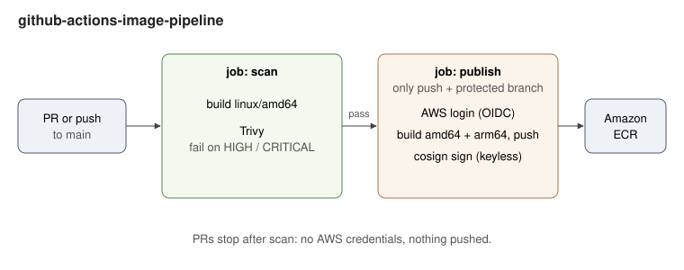

# github-actions-image-pipeline

A GitHub Actions workflow that builds a multi-arch Docker image, scans it with
Trivy, signs it with Cosign and pushes it to Amazon ECR, but only from a
protected branch.



## The problem

> Create a GitHub Actions workflow that builds a multi-arch Docker image, scans
> it with Trivy, signs it with Cosign, and pushes to ECR only on protected
> branches.

## How it works

The workflow is [`.github/workflows/image.yml`](.github/workflows/image.yml). It has two jobs:

| Job | Runs on | What it does |
|---|---|---|
| `scan` | every PR and every push to `main` | builds the image for `linux/amd64`, Trivy fails the job on `HIGH`/`CRITICAL` vulnerabilities that have a fix |
| `publish` | push to a protected branch, after `scan` passes | builds `linux/amd64` + `linux/arm64`, pushes to ECR tagged with the commit SHA, signs the digest with Cosign |

"Only on protected branches" is the `if: github.ref_protected` condition, so
`main` must have a branch protection rule. A PR never gets AWS credentials.

No secrets are stored: AWS login and Cosign signing both use the job's GitHub
OIDC token (`id-token: write`, only in `publish`).

The image itself is a ten-line Go server ([`main.go`](main.go)) on a distroless
non-root base. It only exists so there is something to build.

## Prerequisites

- An ECR repository named `hello`.
- An IAM role GitHub can assume through OIDC, with the policies in [`iam/`](iam/).
- Repository variables (Settings > Secrets and variables > Actions > Variables):
  `AWS_ROLE_ARN`, `AWS_REGION`, `ECR_REPOSITORY` (`hello`).

Step by step commands: [docs/BUILD_GUIDE.md](docs/BUILD_GUIDE.md).

## Verify a signed image

```bash
cosign verify \
  --certificate-identity "https://github.com/johnvega-cloud/github-actions-image-pipeline/.github/workflows/image.yml@refs/heads/main" \
  --certificate-oidc-issuer https://token.actions.githubusercontent.com \
  ACCOUNT_ID.dkr.ecr.REGION.amazonaws.com/hello@sha256:...
```

## Known limits

- Trivy scans the amd64 image only; the arm64 one is built from the same
  source and base but is not scanned on its own.
- Actions are pinned to version tags, not commit SHAs.

## License

MIT
